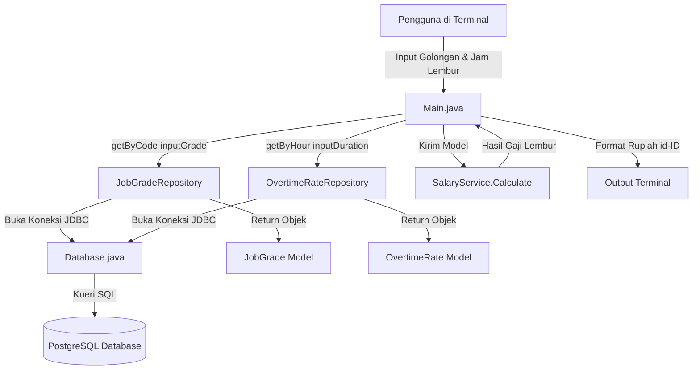

# Aplikasi Penghitungan Gaji & Lembur Karyawan (Java & PostgreSQL)

Aplikasi console berbasis Java yang menerapkan **Layered Architecture (Clean Architecture)** untuk menghitung gaji pokok dan upah lembur karyawan berdasarkan golongan kerja (*Job Grade*) dan durasi lembur (*Overtime Rate*) yang tersimpan di database PostgreSQL.

---

## 1. Struktur Folder Project

Project ini memisahkan tanggung jawab kode ke dalam beberapa layer (*Separation of Concerns*):

```text
tugas3/
├── .env                                  # Kredensial & konfigurasi database
├── docker-compose.yml                    # Konfigurasi container PostgreSQL (Alpine + Healthcheck)
├── README.md                             # Dokumentasi teknis aplikasi
├── lib/                                  # Driver & library JAR
│   ├── dotenv-java-3.2.0.jar             # Parser environment variable
│   └── libpostgresql.jar                 # PostgreSQL JDBC Driver
└── src/
    ├── Main.java                         # Presentation Layer (CLI Input, Validasi, Formatting)
    ├── config/
    │   └── Database.java                 # Infrastructure Layer (Koneksi JDBC & .env)
    ├── model/                            # Domain Layer (Entity POJO)
    │   ├── JobGrade.java                 # Model tabel job_grades
    │   └── OvertimeRate.java             # Model tabel overtime_rates
    ├── repository/                       # Data Access Layer (Query SQL PreparedStatement)
    │   ├── JobGradeRepository.java       # Operasi database tabel job_grades
    │   └── OvertimeRateRepository.java   # Operasi database tabel overtime_rates
    └── service/                          # Business Logic Layer
        └── SalaryService.java            # Aturan perhitungan upah lembur
```

---

## 2. Diagram Arsitektur & Alur Eksekusi



---

## 3. Skema & Data Awal Database

Pastikan tabel berikut sudah tersedia di database PostgreSQL Anda:

```sql
-- 1. Tabel Golongan Kerja (Gaji Pokok)
CREATE TABLE IF NOT EXISTS job_grades (
    id SERIAL PRIMARY KEY,
    code VARCHAR(10) UNIQUE NOT NULL,
    amount INT NOT NULL
);

-- 2. Tabel Tarif Persentase Lembur
CREATE TABLE IF NOT EXISTS overtime_rates (
    id SERIAL PRIMARY KEY,
    hour INT UNIQUE NOT NULL,
    percentage REAL NOT NULL
);

-- Contoh Data Awal
INSERT INTO job_grades (code, amount) VALUES 
('A', 5000000),
('B', 7000000),
('C', 10000000)
ON CONFLICT (code) DO NOTHING;

INSERT INTO overtime_rates (hour, percentage) VALUES 
(1, 0.10),
(2, 0.20),
(3, 0.30),
(4, 0.40),
(5, 0.50)
ON CONFLICT (hour) DO NOTHING;
```

---

## 4. Penjelasan Komponen Kode

### A. Presentation Layer: [src/Main.java](file:///c:/Users/fajar/java/tugas3/src/Main.java)
Berfungsi sebagai antarmuka pengguna berbasis terminal:
* **Membaca Input:** Membaca kode golongan kerja (otomatis diubah ke huruf besar `.toUpperCase()`) dan durasi jam lembur.
* **Aturan Maksimal Lembur:** Jika pengguna memasukkan durasi lebih dari 5 jam, durasi otomatis dibatasi (*capped*) maksimal menjadi 5 jam (`if (inputDuration > 5) inputDuration = 5;`).
* **Format Mata Uang:** Menggunakan `Locale.of("id", "ID")` dan `NumberFormat.getCurrencyInstance(lang)` untuk memformat angka nominal ke standar mata uang Rupiah (`Rp...`).

### B. Business Logic Layer: [src/service/SalaryService.java](file:///c:/Users/fajar/java/tugas3/src/service/SalaryService.java)
Berisi aturan perhitungan bisnis:
* **Fungsi `Calculate(JobGrade jobGrade, OvertimeRate overtimeRate)`:** Menghitung upah lembur dengan rumus:
  $$\text{Gaji Lembur} = \text{Gaji Pokok} \times \text{Persentase Lembur}$$

### C. Data Access Layer: Package `repository`
Mengisolasi seluruh query SQL menggunakan `PreparedStatement` agar aman dari SQL Injection:
* **[JobGradeRepository.java](file:///c:/Users/fajar/java/tugas3/src/repository/JobGradeRepository.java):**
  Method `getByCode(String code)` menjalankan query `SELECT * FROM job_grades WHERE code = ?` dan mengembalikan objek `JobGrade`.
* **[OvertimeRateRepository.java](file:///c:/Users/fajar/java/tugas3/src/repository/OvertimeRateRepository.java):**
  Method `getByHour(Integer hour)` menjalankan query `SELECT * FROM overtime_rates WHERE hour = ?` dan mengembalikan objek `OvertimeRate`.

### D. Domain Layer: Package `model`
Class POJO (Plain Old Java Object) dengan enkapsulasi (field `private` + getter) untuk merepresentasikan entitas:
* **[JobGrade.java](file:///c:/Users/fajar/java/tugas3/src/model/JobGrade.java):** Menyimpan atribut `id`, `code`, dan `amount`.
* **[OvertimeRate.java](file:///c:/Users/fajar/java/tugas3/src/model/OvertimeRate.java):** Menyimpan atribut `id`, `hour`, dan `percentage`.

### E. Infrastructure Layer: [src/config/Database.java](file:///c:/Users/fajar/java/tugas3/src/config/Database.java)
* Membaca variabel koneksi dari file `.env` menggunakan library `dotenv-java`.
* Membuka koneksi JDBC ke database menggunakan `DriverManager.getConnection(...)`.

---

## 5. Konfigurasi Lingkungan

### File `.env`
Letakkan file `.env` pada direktori root project:
```env
POSTGRES_USER=tugas3
POSTGRES_PASSWORD=tug453ju4r4@
POSTGRES_DB=tugas3_db
POSTGRES_HOST=localhost
POSTGRES_PORT=5432
```
*(Catatan: Jika PostgreSQL dijalankan di dalam WSL 2 tanpa mirrored network, sesuaikan `POSTGRES_HOST` dengan IP virtual WSL Anda, misal `10.88.197.66`).*

### File `docker-compose.yml`
Menjalankan container PostgreSQL versi ringan (Alpine) dengan volume persisten dan healthcheck:
```yaml
services:
  db:
    image: postgres:alpine
    container_name: postgres-db
    environment:
      POSTGRES_USER: ${POSTGRES_USER}
      POSTGRES_PASSWORD: ${POSTGRES_PASSWORD}
      POSTGRES_DB: ${POSTGRES_DB}
    ports:
      - "5432:5432"
    volumes:
      - pgdata:/var/lib/postgresql
    networks:
      - app-network
    restart: unless-stopped
    healthcheck:
      test: ["CMD-SHELL", "pg_isready -U ${POSTGRES_USER} -d ${POSTGRES_DB}"]
      interval: 10s
      timeout: 5s
      retries: 5
      start_period: 10s

volumes:
  pgdata:

networks:
  app-network:
    driver: bridge
```

---

## 6. Panduan Menjalankan Aplikasi

### 1. Nyalakan Database
```powershell
docker compose up -d
# atau jika di WSL:
podman compose up -d
```

Pastikan container sudah berstatus `(healthy)`:
```powershell
docker compose ps
```

### 2. Kompilasi Kode Java
Jalankan perintah ini di PowerShell pada root direktori project:
```powershell
& "C:\Program Files\Java\jdk-25.0.4.1\bin\javac.exe" -cp "lib/*" -sourcepath src -d out src/Main.java
```

### 3. Jalankan Aplikasi
```powershell
& "C:\Program Files\Java\jdk-25.0.4.1\bin\java.exe" -cp "out;lib/*" Main
```

---

## 7. Contoh Simulasi Penggunaan di Terminal

### Skenario 1: Input Normal
```text
Masukan Golongan: A
Masukan Durasi: 3
Gaji pokok : Rp5.000.000,00
Gaji Lembur : Rp1.500.000,00
Total Gaji : Rp6.500.000,00
```

### Skenario 2: Lembur Melebihi Batas Maksimal (> 5 Jam)
Jika diinput 8 jam, sistem otomatis menerapkan batas tarif maksimal 5 jam:
```text
Masukan Golongan: B
Masukan Durasi: 8
Gaji pokok : Rp7.000.000,00
Gaji Lembur : Rp3.500.000,00
Total Gaji : Rp10.500.000,00
```

### Skenario 3: Golongan Tidak Ditemukan
```text
Masukan Golongan: Z
Data tidak ditemukan!
```
